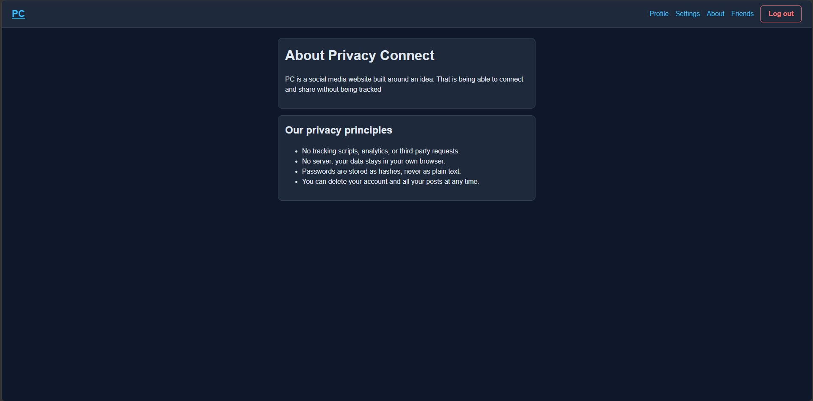
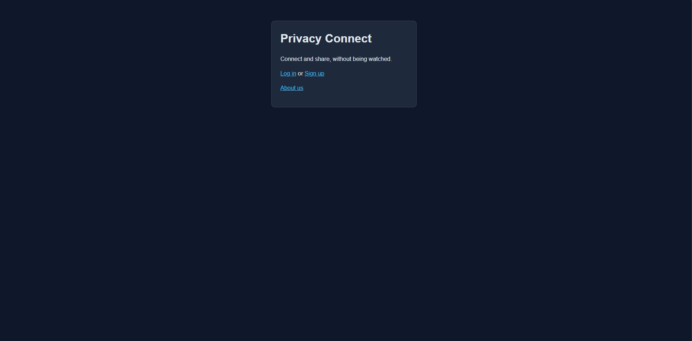
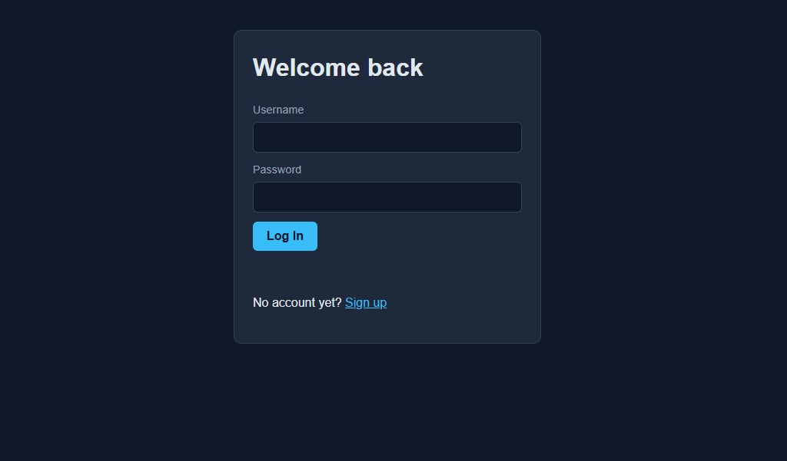
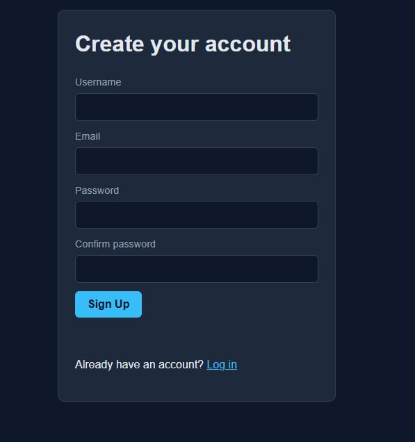
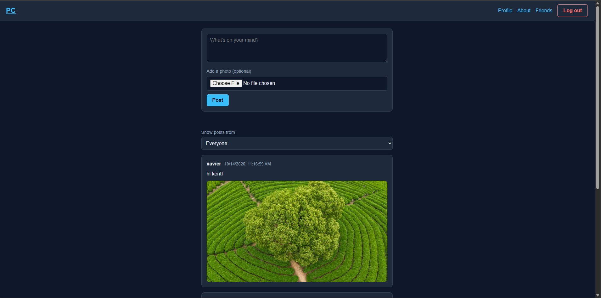
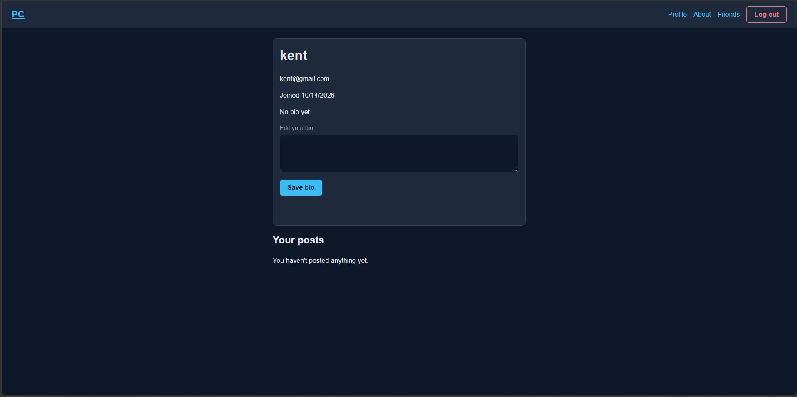
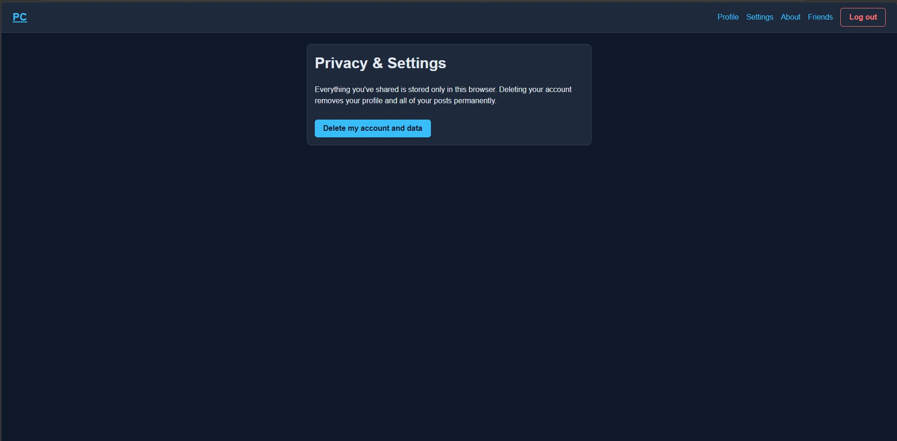
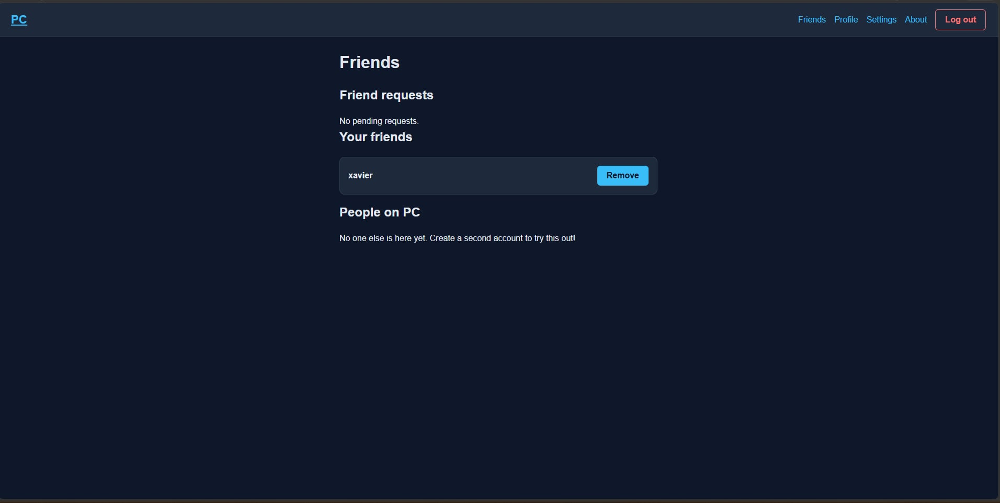

# Privacy Connect (PC)

Privacy Connect(PC) is a social media website built around an idea. That is being able to connect and share without being tracked.

## Idea

AI systems and trackers collect more personal data every day. Privacy Connect is a small social network built around the opposite idea: people should be able to connect, share, and express themselves without being watched. The prototype makes no third-party requests, loads no analytics or tracking scripts, stores passwords only as hashes, strips hidden metadata from photos, requires consent for friendships, and lets users delete their account and posts at any time.

## Features

| Page | File | What it does |
|---|---|---|
| Landing | `index.html` | Entry point with links to log in, sign up, or read About. Redirects to the feed if already logged in. |
| Sign up | `pages/signup.html` | Creates an account (username, email, password). Checks that the passwords match and the username is unique. |
| Log in | `pages/login.html` | Verifies the username and password hash, then starts a session. |
| Feed | `pages/feed.html` | Write text posts, add a photo with a caption, see posts newest first, delete your own posts, and filter between everyone and "me and my friends". |
| Friends | `pages/friends.html` | Send, accept, and decline friend requests, remove friends, and see other people on the app. |
| Profile | `pages/profile.html` | Shows your username, email, join date, and bio. Edit your bio and see your own posts. |
| Settings | `pages/settings.html` | Delete your account, your posts, and your friend connections permanently. |
| About | `pages/about.html` | Explains the privacy principles behind the app. |

The "PC" logo in the navbar links back to the feed from every page.

### Photo posts

A post can contain text, a photo, or both. When a photo is attached, the text box acts as its caption, and the post shows the caption above the photo. Photos are resized in the browser (largest side 800 px) and compressed as JPEG before saving. Re-drawing the photo on a canvas also removes hidden metadata such as GPS location and camera details.

### Friends

Friendship needs consent from both people:

1. Person A sends a request to person B.
2. Person B sees it under **Friend requests** and accepts or declines.
3. On acceptance, each person is added to the other's friends list.

Either friend can remove the connection later, and it disappears for both. The feed filter "Me and my friends" shows posts from you and your accepted friends only.

## Screenshots










## Project structure

```
.
├── index.html                 Landing page
├── pages/
│   ├── login.html             Log in form
│   ├── signup.html            Sign up form
│   ├── feed.html              Main feed, post form, feed filter
│   ├── friends.html           Friend requests, friends, and people
│   ├── profile.html           User profile and own posts
│   ├── settings.html          Account deletion
│   └── about.html             About us
├── src/
│   ├── css/
│   │   └── style.css          All styles, shared by every page
│   └── js/
│       ├── main.js            Shared helpers (storage, session, hashing, friends, photos)
│       ├── signup.js          Sign up logic
│       ├── login.js           Log in logic
│       ├── feed.js            Posting, photos, rendering, filtering, deleting posts
│       ├── friends.js         Friend requests and friends list
│       ├── profile.js         Profile display, bio editing, own posts
│       └── settings.js        Account deletion
└── assets/
    └── img/                   Reserved for images and screenshots
```

## How to run

1. Download or clone this repository.
2. Open `index.html` in a browser, or serve the folder with the VS Code *Live Server* extension (right-click `index.html`, then *Open with Live Server*).
3. Create an account on the sign up page, then log in.
4. To try the friends feature, create a second account (log out, then sign up again) and send a request between the two.

If password hashing fails when opening the file directly, use Live Server. The browser's crypto API works on `localhost`.

## How data is stored

All data lives in the browser's `localStorage` under three keys:

| Key | Contents |
|---|---|
| `users` | Array of `{ username, email, passwordHash, bio, joined, friends, requests }` |
| `posts` | Array of `{ id, author, text, image, time }` (`image` is a compressed photo stored as text, or empty) |
| `currentUser` | `{ username }` of the logged-in user, or absent when logged out |

`friends` is a list of usernames who are accepted friends. `requests` is a list of usernames who have asked to be this user's friend and are waiting for an answer. Accounts created before the friends feature get empty lists the first time they are needed.

`currentUser` holds only the username on purpose. Pages look up the full, current record in `users`, so there is no stale copy of the profile or a second copy of the password hash.

To inspect the data: open the browser dev tools (F12), then Application, then Local Storage.

### Shared helpers (`src/js/main.js`)

| Function | Purpose |
|---|---|
| `getUsers()` / `saveUsers(users)` | Read and write the users array |
| `getPosts()` / `savePosts(posts)` | Read and write the posts array. `savePosts` returns `false` if storage is full. |
| `getCurrentUser()` | Return the logged-in user or `null` |
| `requireLogin()` | Redirect to the login page if nobody is logged in |
| `logout()` | Clear the session and go to the login page |
| `hashPassword(password)` | Return the SHA-256 hash of a password as a hex string |
| `resizeImage(file, maxSize)` | Shrink and compress a photo, returning it as text to store |
| `ensureLists(user)` / `findUser(users, name)` | Make sure a user has `friends` and `requests` lists, and look a user up by name |
| `sendRequest`, `acceptRequest`, `declineRequest`, `removeFriend` | Update both users' friend data and save it |

## Privacy and security decisions

- **Passwords are hashed.** Only a SHA-256 hash is saved, never the password itself.
- **User text is never inserted as HTML.** Posts, captions, bios, and messages are displayed with `textContent`, so a post containing `<script>` or other markup shows as plain text instead of running. This protects against cross-site scripting (XSS).
- **Photos lose their metadata.** Every photo is re-drawn and re-encoded in the browser, which removes EXIF data such as GPS location.
- **Friendship requires consent.** A request does nothing until the other person accepts it.
- **One login error message.** A failed login always says "Invalid username or password," so nobody can tell whether the username exists.
- **No third-party requests.** No CDNs, fonts, analytics, or trackers.
- **User control over data.** Settings deletes the account, the user's posts, and their entries in other people's friend lists.
- **Page guard.** `requireLogin()` sends logged-out visitors to the login page.

## Limitations

This is a frontend-only prototype, and these limits are intentional trade-offs:

- `localStorage` is readable and editable by anyone using the browser, so it is not secure storage.
- `requireLogin()`, "delete only your own posts," and the friend rules are conveniences. Someone with dev tools can bypass them. Real enforcement needs a server.
- SHA-256 without a salt is not production-grade password storage. A real app would use a slow, salted algorithm (such as bcrypt or Argon2) on a backend.
- `localStorage` holds roughly 5 MB per site, so only a few dozen compressed photos fit. When storage is full, the app shows a message and does not save the post.
- Data exists only in one browser. Accounts, posts, and friend requests are not shared between devices or between different people's computers, so friends only work between accounts created in the same browser.
- The people list on the Friends page shows every account in the browser, so users are discoverable by default.
- No password recovery, email verification, or rate limiting.

## Future improvements

- A real backend with proper authentication.
- A shared function for building post cards (the code is currently duplicated in `feed.js` and `profile.js`).
- Search for people by username.
- Likes and comments.
- Per-post privacy (friends only) and blocking.
- Profile pictures using the `assets/img/` folder.
